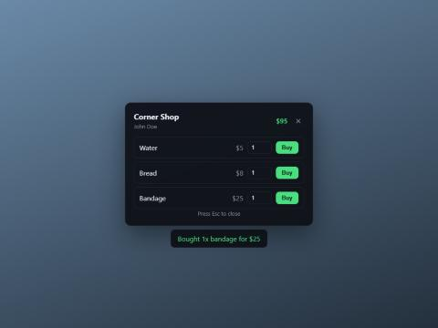

# fivem-kit

[](https://github.com/pondntw/fivem-kit/actions/workflows/ci.yml)
[](LICENSE)

**Build FiveM NUI with React + TypeScript, with types that reach all the way into your Lua, and changes that show up in-game when you save.**

```bash
npm create fivem-kit@latest my-shop
```

<p align="center">
  
</p>

> **Status: 0.1 (alpha).** The generator, bridge and hot reload are tested end to end against a simulated FXServer. Please [open an issue](https://github.com/pondntw/fivem-kit/issues) if something behaves differently on your server.

## Why

Writing NUI for FiveM usually means three things that break silently:

| Problem | What fivem-kit does |
|---|---|
| `SendNUIMessage({ action = 'setPlyer' })`: a typo in a string, and the UI just never updates | Messages are declared once in `bridge.json`. Lua calls `Ui.setPlayer(...)`, the UI listens with `useNuiEvent('setPlayer', ...)`, and both sides are generated from the same file |
| You rename a field in Lua and find out in-game | The generated TypeScript types turn every outdated use in the UI into a compile error, and the Lua side gets [Lua Language Server](https://luals.github.io/) annotations for autocomplete |
| Every UI change means a build, then `restart my-resource` in the console, then reopening the menu | `npm run dev` rebuilds on save and runs `ensure my-resource` over RCON for you |

## What you get

```
my-shop/
├─ bridge.json            ← every Lua ↔ UI message, in one place
├─ fxmanifest.lua         ← ESX / QBCore / standalone, ox_lib and oxmysql already wired in
├─ client/
│  ├─ main.lua            ← example: /myshop opens a shop
│  └─ bridge.gen.lua      ← generated: Ui.* and Nui.* with LuaLS types
├─ server/main.lua        ← example purchase, validated on the server (NaN-safe amounts)
├─ shared/config.lua
└─ web/                   ← Vite + React + TypeScript
   └─ src/
      ├─ App.tsx
      ├─ nui.ts           ← fetchNui / useNuiEvent, typed from the bridge
      ├─ dev.ts           ← mock Lua for browser development
      └─ bridge.gen.ts    ← generated
```

## The bridge

```json
{
  "toUi": {
    "setPlayer": { "name": "string", "cash": "number" }
  },
  "toClient": {
    "buy": {
      "request":  { "item": "string", "amount": "number" },
      "response": { "ok": "boolean", "message": "string?" }
    }
  }
}
```

**Lua (client)**

```lua
Ui.setPlayer({ name = 'John', cash = 120 })   -- LuaLS warns if a field is missing or the wrong type

Nui.buy(function(data)                         -- data.item, data.amount are typed
    local ok, message = lib.callback.await('my-shop:buy', false, data.item, data.amount)
    return { ok = ok, message = message }      -- becomes the value fetchNui resolves with
end)
```

**React (UI)**

```tsx
useNuiEvent('setPlayer', (player) => setCash(player.cash)); // player: { name: string; cash: number }

const res = await fetchNui('buy', { item: 'water', amount: 1 }); // res: { ok: boolean; message?: string }
```

If the Lua handler throws, `fetchNui` rejects with the error message instead of leaving the UI waiting forever.

Field types: `string`, `number`, `boolean`, `any`; add `[]` for arrays and `?` for optional fields. Use `{ ... }` for nested objects and `[{ ... }]` for arrays of objects. `bridge.json` ships with a JSON Schema, so VS Code autocompletes it.

## Commands

Inside a generated project:

| Command | |
|---|---|
| `npm run dev` | Watch Lua, the UI and `bridge.json`; rebuild, then restart the resource in-game over RCON |
| `npm run dev:ui` | Develop the UI in a normal browser with mocked Lua (instant Vite hot reload) |
| `npm run build` | Generate the bridge and build the UI for production |
| `npx fivem-kit gen --check` | Exit with an error if the generated files are stale (useful in CI) |

### Hot reload setup

1. In `server.cfg` (or your startup script): `set rcon_password "<long random password>"`. It is read-only once the server runs, so typing it in the console does not work. RCON listens on the game port, so on a server reachable from the internet use a long random password
2. In the resource folder: copy `.env.example` to `.env` and set `FIVEM_RCON_PASSWORD` to the same value
3. `npm run dev`

When you save several files at once, fivem-kit waits until the saves stop, then sends a single restart. The resource restarts, so its Lua state resets. Without a password, `npm run dev` still rebuilds and tells you to restart the resource yourself.

## How it works

- **`create-fivem-kit`** copies a template and fills in the parts for your framework. It refuses to write into a non-empty folder, and every framework/option combination is checked with `luac -p` in CI.
- **`fivem-kit gen`** validates `bridge.json` (it reports every problem with its path, such as `toClient.buy.request.amount: unknown type "nubmer"`), then writes TypeScript types and Lua wrappers. It only writes files whose content changed, so watchers don't fire for nothing.
- **`fivem-kit dev`** runs Vite in watch mode with the project's own Vite version, watches Lua with `fs.watch`, and talks to FXServer over UDP RCON. Restarts are debounced, and a change that arrives during a restart is queued, not dropped.

## Develop fivem-kit itself

```bash
npm install
npm test        # unit tests (Node's test runner, TypeScript run directly)
npm run e2e     # scaffold a real project, npm install, build, and drive `dev` against a fake FXServer
```

Requires Node 22.18+ for development (TypeScript type stripping). Generated projects need Node 20.12+.

## Roadmap

- [ ] `toServer` messages: typed client ↔ server events with validation generated on the server side
- [ ] Svelte and Vue templates
- [ ] Reload only the NUI page for UI-only changes, without restarting the resource
- [ ] Qbox template

## License

MIT
